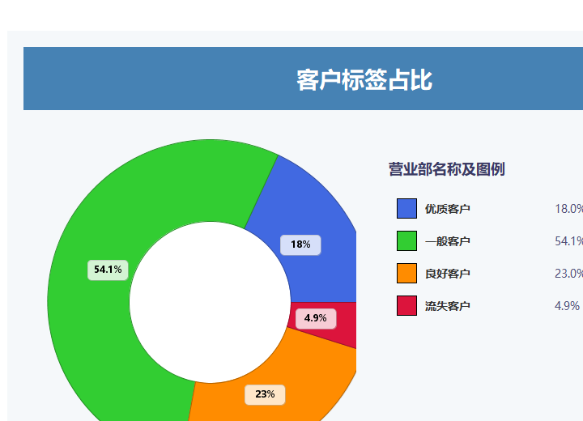
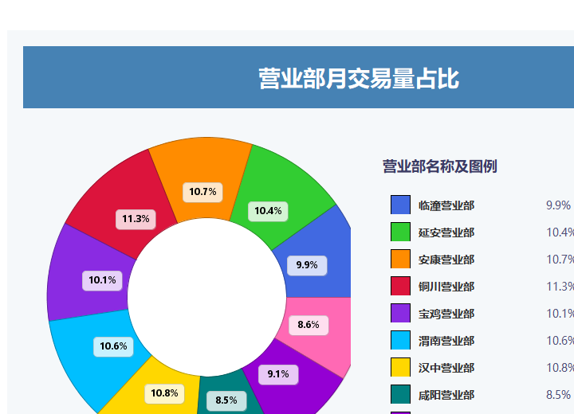

# 证券客户交易数据仓库（Hive + Spark + MySQL）

基于 Hadoop 三节点集群的离线数据仓库实训项目：把证券公司营业部、客户、持仓和交易流水数据，按 **ODS → DWD → DWS → ADS** 四层建模，用 Hive/Spark SQL 计算客户持仓标签、营业部交易排行和月度最佳客户等指标，结果导出到 MySQL，最后通过 5 个 Java Swing 桌面程序做可视化展示。

> 数据为实训环境中构造的模拟数据，不包含真实客户信息。

## 效果展示

| 客户标签占比 | 营业部交易量占比 |
| --- | --- |
|  |  |

## 一、整体架构

```
                 ┌──────────────────────────────┐
                 │  ODS  原始数据层（Parquet）   │
                 │  用户 / 持仓 / 营业部 / 流水   │
                 └──────────────┬───────────────┘
                                │ 清洗、去重、维度拆分
                 ┌──────────────▼───────────────┐
                 │  DWD  明细层                  │
                 │  用户维度 / 营业部维度 / 持仓   │
                 │  / 证券交易明细                │
                 └──────────────┬───────────────┘
                                │ 按主题聚合
                 ┌──────────────▼───────────────┐
                 │  DWS  汇总层                  │
                 │  客户持仓标签 / 营业部月度交易  │
                 │  / 客户月度交易统计            │
                 └──────────────┬───────────────┘
                                │ 指标计算
                 ┌──────────────▼───────────────┐
                 │  ADS  应用层                  │
                 │  TOP5 / 交易总量 / 客户标签占比│
                 │  / 月度最佳业务客户            │
                 └──────────────┬───────────────┘
                                │ Spark JDBC 导出
                 ┌──────────────▼───────────────┐
                 │  MySQL（gcproject）           │
                 └──────────────┬───────────────┘
                                │ JDBC 查询
                 ┌──────────────▼───────────────┐
                 │  Java Swing 桌面展示程序 ×5    │
                 └──────────────────────────────┘
```

## 二、数据分层与表

### ODS 原始层（按 `event_date` 分区，Parquet）

| 表 | 说明 |
| --- | --- |
| `ods_user_info` | 客户基本信息：客户 ID、资金账号、姓名、营业部、手机号、身份证号、年龄、性别、地址、开户日期 |
| `ods_user_stock_hold` | 客户证券持仓市值 |
| `ods_user_etf_hold` | 客户基金（ETF）持仓市值 |
| `ods_business_info` | 营业部信息：名称、地址、成立日期 |
| `ods_stock_deal` | 证券交易流水：交易量、交易金额、交易日期 |

### DWD 明细层

| 表 | 说明 |
| --- | --- |
| `dim_user_info` | 客户维度（去掉冗余的营业部名称等字段） |
| `dim_business_info` | 营业部维度 |
| `dwd_user_stock_hold` | 客户证券持仓 |
| `dwd_user_etf_hold` | 客户基金持仓 |
| `dwd_stock_deal` | 交易明细 |

### DWS 汇总层

| 表 | 说明 |
| --- | --- |
| `dws_user_hold_label` | 客户持仓标签：合并证券、基金持仓，按规则打标签 |
| `dws_business_tran_month` | 营业部月度指标（交易量 / 交易金额 / 交易次数，区分证券与基金） |
| `dws_business_tran_stat_month` | 营业部月度交易统计汇总 |
| `dws_client_tran_stat_month` | 客户月度交易统计 |

### ADS 应用层

| 表 | 说明 |
| --- | --- |
| `ads_user_type` | 客户持仓标签明细（姓名、资金账号、营业部、持仓、标签） |
| `ads_user_type_count` | 各类客户标签数量及占比 |
| `ads_business_id_top5_month` | 营业部月度 TOP5（证券/基金的交易量、交易金额、交易次数） |
| `ads_business_tran_total` | 营业部交易总量 |
| `ads_business_best_client_month` | 各营业部月度“最佳业务客户”（交易量、交易金额、交易次数三项第一） |

### 客户标签口径

| 标签 | 规则 | 含义 |
| --- | --- | --- |
| 1 | 证券持仓 ≥ 100,000 | 优质客户 |
| 2 | 证券 + 基金持仓 ≥ 150,000 | 良好客户 |
| 3 | 证券 + 基金持仓 < 150,000 且至少有一类持仓 | 一般客户 |
| 4 | 证券与基金持仓均为 0 | 流失客户 |

## 三、目录结构

```
.
├── project/                     # 数仓脚本
│   ├── bash_profile             # 公共变量：库名、交易日（默认昨天）
│   ├── ods/
│   │   ├── create_table.sql     # ODS 建表
│   │   ├── sql/                 # 各表装载 SQL（含模拟数据）
│   │   └── bash/                # Hive 执行脚本
│   ├── dwd/
│   │   ├── create_table.sql
│   │   ├── sql/
│   │   └── bash/
│   ├── dws/
│   │   ├── create_table.sql
│   │   ├── sql/
│   │   └── bash/
│   └── ads/
│       ├── create_table.sql         # ADS Hive 建表
│       ├── create_mysql_table.sql   # ADS MySQL 建表
│       ├── sql/                     # 指标计算 SQL
│       ├── bash/                    # Hive 执行
│       ├── sparkbash/               # Spark 执行 + 导出 MySQL
│       └── py/                      # PySpark JDBC 导出脚本
├── 辉煌证券指标中心/             # 桌面展示程序
│   ├── *.jar                    # 5 个可执行 Swing 程序
│   ├── config/data_sources.json # 展示数据源配置
│   ├── data/*.json              # 演示用图表数据
│   └── jdbc.properties.example  # 数据库连接配置模板
└── docs/screenshots/            # 运行效果截图
```

## 四、运行方式

### 1. 环境

- 3 台 CentOS 7 虚拟机：`hadoop1`（主节点）、`hadoop2`、`hadoop3`
- Hadoop（HDFS + YARN）、Hive、Spark
- MySQL 安装在 `hadoop1`，库名 `gcproject`
- 桌面端：JDK 8

### 2. 建表

```bash
# 在 hadoop1 上，按顺序执行
hive -f project/ods/create_table.sql
hive -f project/dwd/create_table.sql
hive -f project/dws/create_table.sql
hive -f project/ads/create_table.sql

# ADS 结果表同步建到 MySQL
mysql -uroot -p gcproject < project/ads/create_mysql_table.sql
```

### 3. 跑批

`project/bash_profile` 里定义了库名和交易日，默认取“昨天”：

```bash
db=gcproject
trade_date=$(date -d "yesterday" +%Y%m%d)
first_day=$(date -d "yesterday" +%Y%m)01
```

各层按 ODS → DWD → DWS → ADS 顺序执行，例如：

```bash
cd project/ods/bash && ./ods_user_info.sh
cd ../../dwd/bash && ./dim_user_info.sh
cd ../../dws/bash && ./dws_user_hold_label.sh
```

### 4. 导出到 MySQL

`project/ads/sparkbash/` 下的脚本负责用 Spark 把 ADS 表写入 MySQL，数据库密码从环境变量读取：

```bash
export MYSQL_HOST=hadoop1
export MYSQL_USER=root
export MYSQL_PASSWORD=你的密码

cd project/ads/sparkbash && ./ads_business_tran_total.sh
```

### 5. 桌面程序

```bash
cd 辉煌证券指标中心
cp jdbc.properties.example jdbc.properties   # 填入本机 MySQL 密码
java -Dfile.encoding=UTF-8 -jar 辉煌证券标签客户占比.jar
```

> Windows 中文环境默认使用 GBK，不加 `-Dfile.encoding=UTF-8` 时程序内的中文标签会显示为乱码。

5 个程序分别对应：

| 程序 | 功能 |
| --- | --- |
| `辉煌证券标签客户占比.jar` | 优质 / 良好 / 一般 / 流失客户数量与占比 |
| `辉煌证券用户持仓标签.jar` | 客户持仓标签明细表（分页、筛选） |
| `辉煌证券营业部交易总量占比.jar` | 各营业部交易总量占比（饼图） |
| `辉煌证券营业部月度TOP5.jar` | 营业部月度指标 TOP5（柱状图 + 切换指标） |
| `辉煌证券营业部月度指标最佳业务客户.jar` | 各营业部交易量/金额/次数第一的客户 |

## 五、项目要点

- **分层建模**：ODS 保留原始流水，DWD 做维度拆分与清洗，DWS 按主题聚合，ADS 直接面向展示指标，层与层之间通过 `event_date` 分区衔接。
- **增量分区**：所有明细表按交易日分区，跑批脚本通过 `-hivevar trade_date` 注入日期，可按天重跑。
- **指标复用**：客户标签、月度统计在 DWS 一次计算，ADS 只做组合与排序，避免重复扫描明细。
- **展示与计算分离**：ADS 结果通过 Spark JDBC 落到 MySQL，桌面程序只做查询和图表渲染。
- **凭据外置**：数据库密码通过环境变量或本地 `jdbc.properties` 提供，不写入代码仓库。

## 六、说明

- 仓库中的客户姓名、手机号、身份证号等均为实训模拟数据。
- `jdbc.properties` 已被 `.gitignore` 忽略，克隆后请从 `jdbc.properties.example` 复制并填写。
- 集群、Hive 元数据库和虚拟机镜像不在仓库内，需要按实训环境自行搭建。
